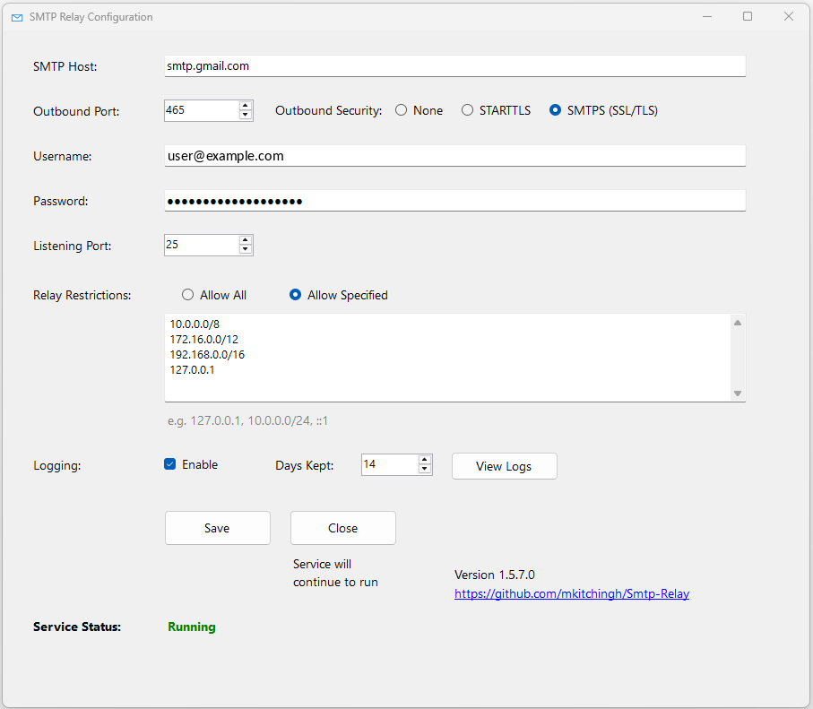

# Windows SMTP Relay Service
Microsoft removed the built in SMTP relay server from Windows. This is a replacement.

Every other option I could find was no longer developed, overkill, or lacking features unless you used the paid version. 

It is actively being developed and I will always try to keep it up to to date with current technologies.

Config GUI shown below. All options are pretty basic and self explanatory. Service will continue to run when the GUI is closed.
GUI will launch after install. It may take a few seconds while Windows scans it for the first time. Start menu shortcut is named SMTP Relay Config.

This app does not phone home. No telemetry, no update checks, no external connections of any kind beyond relaying your mail.

Current release: [https://github.com/mkitchingh/Smtp-Relay/releases/latest/download/SmtpRelaySetup.exe](https://github.com/mkitchingh/Smtp-Relay/releases/latest/download/SmtpRelaySetup.exe)

**You may see Windows Defender or Unknown Publisher messages when you install. I'd prefer not to pay the code signing certificate cost, but I will if it causes a problem for people.  



## Silent / Unattended Installation

The installer supports a `/SILENT` flag and an optional `/config=` parameter for automated or mass deployment.

**Basic silent install** (GUI launches after install to complete configuration):
```
SmtpRelaySetup.exe /SILENT
```

**Silent install with a pre-built config file** (GUI will not launch):
```
SmtpRelaySetup.exe /SILENT /config="C:\path\to\config.json"
```

The config file is the same `config.json` the service uses at runtime. Take one from an existing installation at `C:\Program Files\SMTP Relay\config.json` and use it as a template for deployment.

`/config=` accepts a relative path as well as an absolute one. A relative path is looked for in the current directory, then beside the installer, then in the installer's parent folder, so deployment layouts like this work as written:

```
cd C:\deploy
assets\SmtpRelaySetup.exe /SILENT /config="assets\config.json"
```

If the file cannot be found, Setup stops instead of installing with no configuration. Under `/SILENT` it reports through the exit code and the `/LOG=` file rather than showing a dialog, so an unattended deployment never blocks on a prompt.
